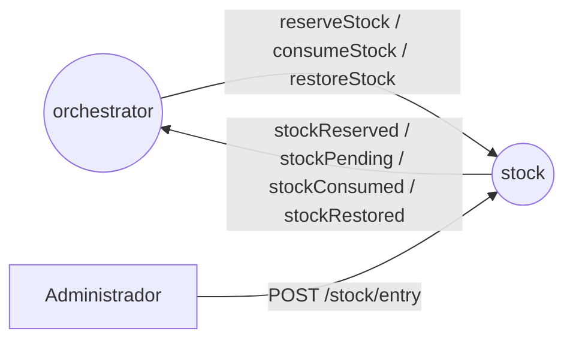
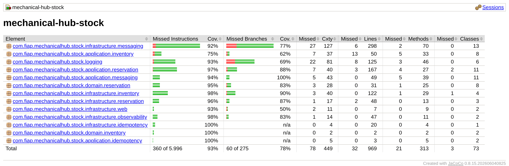

# mechanical-hub-stock

Controla o saldo de materiais da oficina no Mechanical Hub: reserva os materiais de cada ordem, baixa o reservado quando a ordem termina, devolve a reserva nas compensações e resolve as pendências de material por antiguidade.
Kotlin, Java 25, Spring Boot 4.1, PostgreSQL 16 (Flyway), Amazon SQS FIFO, springdoc-openapi.

[](https://github.com/mechanical-hub-fiap/mechanical-hub-stock/actions/workflows/deploy.yml) [](https://sonarcloud.io/summary/new_code?id=mechanical-hub-stock) [](https://sonarcloud.io/summary/new_code?id=mechanical-hub-stock)

## Responsabilidade

- **Faz:** saldo por status (`AVAILABLE`, `RESERVED`), reserva, baixa e devolução dos materiais de uma ordem, pendências com fila por antiguidade, entrada de material e alerta de falta aos administradores.
- **Não faz:** preço de material (`billing`), ordens e reparos (`orders`), estado da saga (`orchestrator`).
- **Fora do escopo por enquanto:** cadastro de materiais (FR-08), consulta de pendências (FR-05), prazo de pendência (FR-01). Detalhes em [Decisões e limitações](docs/mechanical-hub-stock-architecture-spec.md#9-decisões-e-limitações).

## Papel na saga



O orquestrador pede a reserva depois do diagnóstico, a baixa depois da finalização e a devolução nas compensações. Se faltar material, o stock reserva o que há e responde `stockPending`; quando uma entrada ou uma devolução cobre a falta, emite `stockReserved` e a saga segue. Invariante: se há pendência de um material, o `AVAILABLE` dele é 0. Estratégia: [RFC-0005](https://github.com/mechanical-hub-fiap/mechanical-hub-orchestrator/blob/main/docs/rfc/RFC-0005-saga-orquestrada.md) / [ADR-0005](https://github.com/mechanical-hub-fiap/mechanical-hub-orchestrator/blob/main/docs/adr/ADR-0005-divisao-em-microsservicos.md).

## Stack

| Linguagem/framework | Banco | Mensageria | Testes | Qualidade | Observabilidade |
|---|---|---|---|---|---|
| Kotlin, Java 25, Spring Boot 4.1 | PostgreSQL 16 + Flyway | Amazon SQS FIFO | JUnit, Testcontainers | JaCoCo, ktlint, detekt, SonarQube Cloud | OpenTelemetry, Prometheus, Grafana |

## Como rodar

- **Pré-requisitos:** JDK 25 e Docker.
- **Dependências locais:** `docker compose up -d` sobe PostgreSQL 16 e LocalStack (filas FIFO + DLQs de `localstack/init-queues.sh`).
- **Variáveis de ambiente:** [`.env.example`](.env.example); sem chave AWS (na nuvem os pods usam a `LabRole`).
- **Rodar e verificar:**

```bash
docker compose up -d
./mvnw spring-boot:run                               # Flyway aplica migrations e seeds
curl -s http://localhost:8080/actuator/health        # {"status":"UP"}
```

## API

| Método | Rota | Descrição |
|---|---|---|
| POST | `/stock/entry` | Entrada de material (`Idempotency-Key` obrigatório); resolve pendências |
| GET | `/stock` | Saldo `AVAILABLE` e `RESERVED` por material |
| GET | `/stock/{materialId}/movements` | Movimentações do material |

Rotas do administrador, via API Gateway (headers `x-user-*`). Swagger em `/swagger-ui.html`; Postman em [`docs/api/mechanical-hub-stock.postman_collection.json`](docs/api/mechanical-hub-stock.postman_collection.json). Erros: [Interface síncrona](docs/mechanical-hub-stock-architecture-spec.md#4-interface-síncrona-rest).

## Mensagens

- **Consome:** `reserveStock`, `consumeStock`, `restoreStock`.
- **Publica:** `stockReserved`, `stockPending`, `stockConsumed`, `stockRestored`.
- Contratos, filas e idempotência: [Interface assíncrona](docs/mechanical-hub-stock-architecture-spec.md#5-interface-assíncrona-mensagens).

## Dados

PostgreSQL, porque o saldo exige alta consistência, locks de linha e transações ACID. Detalhes em [Modelo de dados](docs/mechanical-hub-stock-architecture-spec.md#6-modelo-de-dados).

## Testes e cobertura

```bash
./mvnw -q verify                       # unitários, ktlint e detekt (sem Docker)
./mvnw -q verify -Pintegration-tests   # + integração, concorrência e fluxos da saga (Testcontainers) e jacoco:check
```



Relatório JaCoCo da última execução completa de `verify` (2026-11-02): **96,7% de linhas** e 78,2% de branches. Meta: ≥ 80% de linhas (o build falha abaixo disso no profile `integration-tests`, que o CI sempre usa). `SagaFlowTests` cobre caminho feliz, pendência resolvida por entrada, recusa e pagamento não confirmado com redistribuição.

## CI/CD

Build → testes → SonarQube Cloud (quality gate) → imagem no ECR → deploy no EKS → smoke test. Workflow: [`deploy.yml`](.github/workflows/deploy.yml); executado também pela pipeline única [`deploy-all.yml`](https://github.com/mechanical-hub-fiap/mechanical-hub-infra/blob/main/.github/workflows/deploy-all.yml) do `mechanical-hub-infra`.

## Observabilidade

Logs JSON com `orderId`, `status`/`stage` e `materialId`; métricas `stock_balance`, `stock_pending_items_total` e `outbox_oldest_pending_age_seconds` no Prometheus; traces OpenTelemetry pelo SQS. Padrão: [logging-standard](https://github.com/mechanical-hub-fiap/mechanical-hub-orchestrator/blob/main/docs/engineering/logging-standard.md).

## Documentação

- Arquitetura deste serviço: [`docs/mechanical-hub-stock-architecture-spec.md`](docs/mechanical-hub-stock-architecture-spec.md)
- Documentação do sistema: [diagrama](https://github.com/mechanical-hub-fiap/mechanical-hub-orchestrator/blob/main/docs/architecture/mechanicalHubFase4Diagrama-v2.png) · [saga](https://github.com/mechanical-hub-fiap/mechanical-hub-orchestrator/blob/main/docs/design/saga_transaction_status.md) · [ADRs](https://github.com/mechanical-hub-fiap/mechanical-hub-orchestrator/tree/main/docs/adr) · [RFCs](https://github.com/mechanical-hub-fiap/mechanical-hub-orchestrator/tree/main/docs/rfc) · [TDs](https://github.com/mechanical-hub-fiap/mechanical-hub-orchestrator/tree/main/docs/design/distributedTransaction) · [data model](https://github.com/mechanical-hub-fiap/mechanical-hub-orchestrator/blob/main/docs/design/data_model.md)
- Outros serviços: [mechanical-hub-orchestrator](https://github.com/mechanical-hub-fiap/mechanical-hub-orchestrator) · [mechanical-hub-orders](https://github.com/mechanical-hub-fiap/mechanical-hub-orders) · [mechanical-hub-billing](https://github.com/mechanical-hub-fiap/mechanical-hub-billing)
