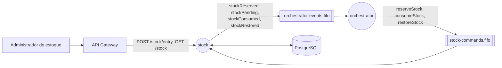

# mechanical-hub-stock — Arquitetura

Descreve o que o serviço faz e como está construído. Regras de negócio detalhadas e o passo a passo de cada fluxo ficam nos documentos do sistema, publicados em [`mechanical-hub-orchestrator/docs`](https://github.com/mechanical-hub-fiap/mechanical-hub-orchestrator/tree/main/docs).

## 1. Visão geral

O stock controla o saldo de materiais da oficina. Reserva os materiais de uma ordem, baixa o reservado quando a ordem termina e devolve a reserva nas compensações. Quando falta material, registra a pendência e a resolve por antiguidade assim que entra material novo ou outra ordem devolve a reserva.

## 2. Responsabilidades e fronteiras

**Dados que o serviço possui**

| Dado | Tabela |
|---|---|
| Materiais (sem preço) | `materials` |
| Saldo por material e status (`AVAILABLE`, `RESERVED`) | `stock` |
| Materiais e quantidades exigidos por reparo | `service_materials` |
| Histórico de movimentações (`ENTRY`, `RESERVED`, `RETURN`, `OUT`, `EXCLUDED`) | `stock_movements` |
| Faltas de material por ordem, em fila por antiguidade | `stock_pending_items` |

**O que ele não faz e quem faz**

| Assunto | Dono |
|---|---|
| Preço de material | `billing` |
| Ordens, reparos e status da ordem (inclusive exibir a pendência ao mecânico) | `orders` |
| Estado da saga e decisão do próximo passo | `orchestrator` |

Invariante preservada em todo o código: se existe pendência de um material, o `AVAILABLE` dele é 0.

## 3. Estrutura interna

Clean Architecture organizada por contexto, com dependências apontando para dentro (`infrastructure → application → domain`):

| Pacote | Conteúdo | Pode depender de |
|---|---|---|
| `domain/inventory` | Enums de status de saldo e tipo de movimentação | nada |
| `domain/reservation` | `StockReservation` (necessidade por material, reserva parcial), `PendingItem`, `MaterialQuantity` | nada |
| `application/inventory` | `RegisterStockEntryUseCase`, consultas e porta `StockRepository` | `domain` |
| `application/reservation` | `ReserveStockUseCase`, `ConsumeStockUseCase`, `RestoreStockUseCase`, `PendingItemsResolver` (rotina única de resolução por antiguidade), portas `StockLocks` e `StockShortageNotifier` | `domain` |
| `application/messaging` | `StockCommandProcessor`, portas `InboxStore` e `OutboxPublisher` | `domain` |
| `application/idempotency` | Porta `IdempotencyStore` do `POST /stock/entry` | — |
| `infrastructure` | Adapters JDBC, locks no PostgreSQL, controller REST, listener SQS, relay do outbox, jobs de retenção, métricas, segurança | `application`, `domain` |
| `logging` | `FlowLog`: logs de etapa no formato do padrão de logs | — |

Componentes principais:

| Componente | Papel |
|---|---|
| `StockController` | Entrada de material e consultas (exige headers do gateway) |
| `StockCommandListener` + `StockCommandConsumer` | Consomem os comandos, deduplicam pelo inbox e classificam erros |
| `PendingItemsResolver` | Usado pela entrada e pela devolução: reserva `min(AVAILABLE, faltante)` para as ordens mais antigas até o `AVAILABLE` zerar |
| `JdbcStockLocks` | Locks de material em ordem crescente de `material_id` e `pg_advisory_xact_lock` por ordem |
| `LogStockShortageNotifier` | Alerta de falta aos administradores após o commit do `stockPending` |
| `OutboxRelay` | Publica os eventos pendentes, só na instância líder |
| `RetentionJobs` | Limpeza diária de inbox e idempotência |

## 4. Interface síncrona (REST)

Rotas do administrador do estoque, via API Gateway, que injeta `x-user-id`, `x-user-role` e `x-user-name`.

| Método | Rota | Body / headers | Efeito | Erros |
|---|---|---|---|---|
| POST | `/stock/entry` | `{ materialId, quantity }` + `Idempotency-Key` (obrigatório) | Soma ao `AVAILABLE`, registra `ENTRY` e resolve pendências do material por antiguidade; publica `stockReserved` para cada ordem que zerar as faltas | `400` sem chave; `422` mesma chave com outro corpo; `404` material inexistente; `503` falha transitória. Mesma chave e mesmo corpo → resposta armazenada |
| GET | `/stock` | — | Saldo `AVAILABLE` e `RESERVED` por material | — |
| GET | `/stock/{materialId}/movements` | — | Movimentações do material | `404` |

Swagger via springdoc (`/swagger-ui.html`, fora do gateway). Collection Postman: [`docs/api/mechanical-hub-stock.postman_collection.json`](api/mechanical-hub-stock.postman_collection.json).

## 5. Interface assíncrona (mensagens)

### 5.1 Envelope e convenções

JSON em filas SQS FIFO, com `eventId`, `transactionId`, `orderId`, `type`, `version`, `timestamp` + payload. `MessageGroupId = orderId` e `MessageDeduplicationId = eventId`. Os comandos recebidos trazem `idempotencyKey = {transactionId}:{STEP}`, chave do `inbox_events`. O contexto de trace viaja nos *message attributes*.

### 5.2 Filas

| Direção | Fila | DLQ |
|---|---|---|
| Lê | `mechanical-hub-stock-commands.fifo` | `mechanical-hub-stock-commands-dlq.fifo` |
| Escreve | `mechanical-hub-orchestrator-events.fifo` | — |

### 5.3 Mensagens consumidas

| Tipo | Fila | Payload | Efeito no serviço | Idempotência |
|---|---|---|---|---|
| `reserveStock` | stock-commands | `repairs[{repairId}]` | Soma a necessidade por material a partir de `service_materials`; em ordem crescente de `material_id` move `AVAILABLE → RESERVED`. Saldo insuficiente: reserva o disponível e grava o faltante em `stock_pending_items` | inbox por `{transactionId}:RESERVE_STOCK`; duplicata regrava a resposta guardada |
| `consumeStock` | stock-commands | `reservedMaterials[{materialId, quantity}]` | Baixa do `RESERVED` (`OUT`); o `AVAILABLE` não muda | inbox |
| `restoreStock` | stock-commands | `reservedMaterials` | Lock da ordem; devolve `RESERVED → AVAILABLE` (`RETURN`) e roda a resolução de pendências para cada material devolvido | inbox |

### 5.4 Mensagens publicadas

| Tipo | Fila | Payload | Quando é emitida |
|---|---|---|---|
| `stockReserved` | orchestrator-events | `reservedMaterials[{materialId, quantity}]` (soma das movimentações `RESERVED` da ordem) | `reserveStock` sem faltas; ou pendência zerada por entrada de material ou por devolução de outra ordem |
| `stockPending` | orchestrator-events | — | `reserveStock` com ao menos um material faltante |
| `stockConsumed` | orchestrator-events | — | Após `consumeStock` |
| `stockRestored` | orchestrator-events | — | Após `restoreStock` |

## 6. Modelo de dados

PostgreSQL 16 (RDS próprio, provisionado pelo `mechanical-hub-database`), migrations Flyway. Relacional porque o saldo exige alta consistência, locks de linha e transações ACID.

| Tabela | Conteúdo | Chaves e índices |
|---|---|---|
| `materials` | `name`, `description`, `min_stock_quantity` | PK `id` (= `materialId` compartilhado com `billing`) |
| `stock` | `material_id`, `status`, `quantity ≥ 0` | UK `(material_id, status)` |
| `service_materials` | `service_id` (= `repairId`, sem FK), `material_id`, `quantity` | UK `(service_id, material_id)` |
| `stock_movements` | `material_id`, `service_order_id` (nulo em `ENTRY`), `movement_type`, `quantity` | índices `(material_id, created_at)` e `service_order_id` |
| `stock_pending_items` | `service_order_id`, `saga_transaction_id`, `material_id`, `quantity` | índice FIFO `(material_id, created_at, id)`; índice `service_order_id` |
| `outbox_events` | `sequence`, `event_id`, `aggregate_id`, `event_type`, `payload` (JSONB), `status`, `attempts`, `last_error`, `sent_at` | UK `event_id`; índice parcial `sequence WHERE status = 'PENDING'` |
| `inbox_events` | `message_key`, `response_payload`, `processed_at` | PK `message_key` |
| `idempotency_requests` | `idempotency_key`, `request_hash`, `response_status`, `response_body` | PK `idempotency_key` |

- **Limpeza:** job diário (03:00) apaga `inbox_events` com mais de 30 dias e `idempotency_requests` com mais de 7 dias. O outbox é permanente.
- **Migrations:** `V1` domínio, `V2` controle, `V3` catálogo fixo de materiais, saldo inicial e materiais por reparo (mesmos UUIDs de `orders` e `billing`; inclui materiais com saldo 0 e baixo para demonstrar a pendência). Não há endpoint de cadastro de material.

## 7. Consistência e tratamento de falhas

- **Atomicidade:** movimentação de saldo e evento correspondente na mesma transação (alteração + `outbox_events`). O alerta de falta sai depois do commit; falha no envio só gera log.
- **Concorrência:** locks de material sempre em ordem crescente de `material_id` (`SELECT … FOR UPDATE`); `pg_advisory_xact_lock` por ordem na resolução de pendências e no `restoreStock`. A contagem de pendências é feita sob o lock da ordem, então exatamente uma transação publica o `stockReserved`. `SET LOCAL lock_timeout = '5s'`; deadlock e `lock_timeout` são transitórios (`503` no REST, retry na fila).
- **Retry:** erro transitório não apaga a mensagem e ajusta o *visibility timeout* pela `ApproximateReceiveCount` (1 s → 8 s); DLQ nativa após 6 recebimentos.
- **DLQ:** erro permanente (contrato inválido; `RESERVED` menor que a quantidade a baixar ou devolver) vai direto à DLQ e gera alerta.
- **Duplicada:** o inbox ignora o comando já processado e regrava a resposta guardada; o `POST /stock/entry` é idempotente pela `Idempotency-Key`.
- **Fora de ordem:** o orquestrador só envia o comando do passo atual e descarta respostas fora do passo; o `stockReserved` gerado para outras ordens pela redistribuição é tratado pela guarda de passo do orquestrador.
- **Relay:** a cada 1 s, lotes de 100 por `sequence`, liderança por `pg_try_advisory_lock`; erro interrompe o lote e incrementa `attempts`.
- **Papel nas compensações:** executa o `restoreStock` (orçamento recusado e pagamento não confirmado) e redistribui o material devolvido às ordens pendentes mais antigas.

## 8. Observabilidade

- **Logs:** JSON com mensagem em logfmt conforme o [padrão de logs](https://github.com/mechanical-hub-fiap/mechanical-hub-orchestrator/blob/main/docs/engineering/logging-standard.md): `orderId`, `status`, `stage`, `attempt`, `durationMs` e contexto (`materialId`, `requestedQty`, `availableQty`, `reservationStatus`); no JSON também `service`, `transactionId`, `eventId`, `trace_id`, `span_id`.
- **Métricas** (`/actuator/prometheus`): `outbox_oldest_pending_age_seconds`, `stock_pending_items_total` e `stock_balance` (saldo `AVAILABLE`/`RESERVED` por material).
- **Traces:** agente OpenTelemetry; o contexto segue pelo SQS até o orquestrador.

## 9. Decisões e limitações

Decisões relacionadas:

- [RFC-0005 — Saga orquestrada](https://github.com/mechanical-hub-fiap/mechanical-hub-orchestrator/blob/main/docs/rfc/RFC-0005-saga-orquestrada.md) e [RFC-0006 — Persistência por serviço](https://github.com/mechanical-hub-fiap/mechanical-hub-orchestrator/blob/main/docs/rfc/RFC-0006-persistencia-por-servico.md)
- [ADR-0004 — Banco de dados por microsserviço](https://github.com/mechanical-hub-fiap/mechanical-hub-orchestrator/blob/main/docs/adr/ADR-0004-banco-de-dados-por-microsservico.md)
- [ADR-0007 — Outbox e inbox](https://github.com/mechanical-hub-fiap/mechanical-hub-orchestrator/blob/main/docs/adr/ADR-0007-outbox-e-inbox.md)
- Fluxos: [ordem completa](https://github.com/mechanical-hub-fiap/mechanical-hub-orchestrator/blob/main/docs/design/distributedTransaction/td_finished_os.md) (passos 7 e 22), [pendência de estoque](https://github.com/mechanical-hub-fiap/mechanical-hub-orchestrator/blob/main/docs/design/distributedTransaction/td_stock_pending.md), [orçamento recusado](https://github.com/mechanical-hub-fiap/mechanical-hub-orchestrator/blob/main/docs/design/distributedTransaction/td_budget_refused.md) (R3), [pagamento não confirmado](https://github.com/mechanical-hub-fiap/mechanical-hub-orchestrator/blob/main/docs/design/distributedTransaction/td_payment_failed.md) (F7)

Fora do escopo por enquanto (requisitos futuros):

- Cadastro de materiais e de materiais por reparo: catálogo fixo nas migrations (FR-08).
- Consulta dos itens pendentes por ordem ou por material (FR-05) e prazo máximo de pendência (FR-01).
- Movimentação `EXCLUDED` (existe no enum, sem fluxo na Fase 4).
